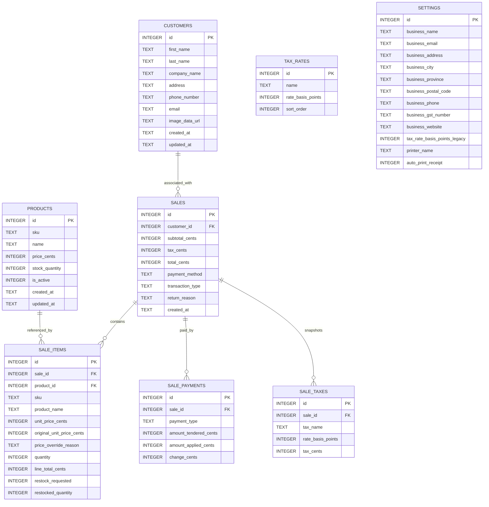

# Database Design

## 1. Overview

The MVP uses a single local SQLite database. The database stores customers, products, completed sales, sale line items, and application settings.

The database file must be created in Electron's writable application data directory and must not be committed to Git.

## 2. Tables

### customers

Stores customer contact details and an optional image. Image data is stored in the database so it remains part of the same local data file.

| Column | Type | Constraints | Purpose |
|---|---|---|---|
| id | INTEGER | PRIMARY KEY | Internal customer identifier |
| first_name | TEXT | NOT NULL, default empty | Customer first name |
| last_name | TEXT | NOT NULL, default empty | Customer last name |
| company_name | TEXT | NOT NULL, default empty | Customer company |
| address | TEXT | NOT NULL, default empty | Customer address |
| phone_number | TEXT | NOT NULL, default empty | Customer telephone number |
| email | TEXT | NOT NULL, default empty | Customer email address |
| image_data_url | TEXT | nullable | Optional PNG, JPEG, or WebP image |
| created_at | TEXT | NOT NULL | Creation timestamp |
| updated_at | TEXT | NOT NULL | Last update timestamp |

At least one of first name, last name, or company name is required. Other contact details are optional.

### products

Stores the current product catalog.

| Column | Type | Constraints | Purpose |
|---|---|---|---|
| id | INTEGER | PRIMARY KEY | Internal product identifier |
| sku | TEXT | UNIQUE, NOT NULL | Code typed by the cashier; reserved permanently |
| name | TEXT | NOT NULL | Current product name |
| price_cents | INTEGER | NOT NULL | Current selling price in cents |
| stock_quantity | INTEGER | nullable | Current stock if inventory tracking is enabled |
| is_active | INTEGER | NOT NULL, default 1 | Soft-delete/deactivation flag |
| created_at | TEXT | NOT NULL | Creation timestamp |
| updated_at | TEXT | NOT NULL | Last update timestamp |

Money is stored as integer cents rather than floating-point values.

Example:

```text
$12.99 -> 1299
```

### sales

Stores one row per completed transaction.

| Column | Type | Constraints | Purpose |
|---|---|---|---|
| id | INTEGER | PRIMARY KEY | Internal database identifier |
| transaction_type | TEXT | NOT NULL | `sale` or `return`; old rows default to `sale` |
| customer_id | INTEGER | nullable, FK | Customer selected for this transaction |
| transaction_number | TEXT | UNIQUE | Customer-facing number in `YYYYMMDD-0001` format |
| return_reason | TEXT | nullable | Required for a return; internal history/CSV field |
| subtotal_cents | INTEGER | NOT NULL | Pre-tax amount magnitude |
| tax_cents | INTEGER | NOT NULL | Tax amount magnitude |
| total_cents | INTEGER | NOT NULL | Final amount magnitude |
| payment_method | TEXT | NOT NULL | Legacy cash/card compatibility value; detailed tenders are in `sale_payments` |
| created_at | TEXT | NOT NULL | Transaction timestamp |

Stored amounts remain non-negative magnitudes to preserve existing database constraints. The main-process API exposes return subtotal, tax, total, item prices, and payouts as negative values. Sales display as Invoice # and returns as Return #, using the persisted `transaction_number`. The daily sequence is shared by sales and returns. The existing `sales.id` remains the internal database key.

### sale_items

Stores the line items belonging to a completed sale.

| Column | Type | Constraints | Purpose |
|---|---|---|---|
| id | INTEGER | PRIMARY KEY | Line item identifier |
| sale_id | INTEGER | NOT NULL, FK | Parent sale |
| product_id | INTEGER | nullable, FK | Original product when available |
| sku | TEXT | NOT NULL | SKU snapshot at sale time |
| product_name | TEXT | NOT NULL | Name snapshot at sale time |
| unit_price_cents | INTEGER | NOT NULL | Price snapshot at sale time |
| original_unit_price_cents | INTEGER | NOT NULL | Catalog price used to identify a transaction override |
| price_override_reason | TEXT | nullable | Required reason when the cashier changes the line price |
| quantity | INTEGER | NOT NULL | Positive sold or returned quantity |
| line_total_cents | INTEGER | NOT NULL | Unit price x quantity |
| restock_requested | INTEGER | NOT NULL | Whether staff selected restocking for a return line |
| restocked_quantity | INTEGER | NOT NULL | Actual quantity added to tracked stock; zero for sales or untracked items |

The SKU, name, original catalog price, final unit price, and override reason are copied into `sale_items`. Historical transactions must remain correct even if a product is renamed, repriced, or removed later. A transaction override never updates `products.price_cents`. Return items use the current catalog price and tax rates, do not link to an invoice, and keep a positive quantity with signed amounts exposed by the API.

### sale_payments

Stores each tender entered for a completed sale or payout. A transaction can have multiple rows when split tender is used.

| Column | Type | Constraints | Purpose |
|---|---|---|---|
| id | INTEGER | PRIMARY KEY | Payment identifier |
| sale_id | INTEGER | NOT NULL, FK | Parent sale |
| payment_type | TEXT | NOT NULL | cash, debit, credit; historical mastercard, visa, or unknown card |
| amount_tendered_cents | INTEGER | nullable | Positive amount received or paid out; unavailable for some historical cash sales |
| amount_applied_cents | INTEGER | NOT NULL | Portion applied to the sale total or return payout |
| change_cents | INTEGER | NOT NULL | Cash returned for a sale; zero for card and return transactions |

For sale tenders, `amount_tendered_cents = amount_applied_cents + change_cents`. Return payouts must equal the negative transaction total in magnitude, with no change. Reports show received, refunded, and net amounts by Cash/Card. The migration backfills older sales with the recorded sale total applied and zero change; older card subtype is unknown, and older cash tendered amounts remain unknown. Zero-total historical sales retain their previously recorded payment type with zero applied.

SKUs are trimmed and stored uppercase before database writes. An SKU remains reserved after its product is deactivated, and the unique constraint applies across active and inactive products. Changing an active product's SKU releases its previous value.

### tax_rates

Stores each tax used for new checkout totals. Multiple taxes are calculated independently on the pre-tax subtotal and rounded to cents individually.

| Column | Type | Constraints | Purpose |
|---|---|---|---|
| id | INTEGER | PRIMARY KEY | Tax identifier |
| name | TEXT | NOT NULL, 1–60 characters | Display name such as GST or PST |
| rate_basis_points | INTEGER | NOT NULL, 0–10000 | Tax percentage in basis points |
| sort_order | INTEGER | NOT NULL | Display order in checkout and receipts |

### sale_taxes

Stores a snapshot of the tax lines used when a sale was completed. Editing or removing a tax later does not change historical sales.

| Column | Type | Constraints | Purpose |
|---|---|---|---|
| id | INTEGER | PRIMARY KEY | Snapshot identifier |
| sale_id | INTEGER | NOT NULL, FK | Parent sale |
| tax_name | TEXT | NOT NULL | Tax name at sale time |
| rate_basis_points | INTEGER | NOT NULL | Rate at sale time |
| tax_cents | INTEGER | NOT NULL | Rounded amount charged for this tax |

### settings

The MVP can use a single settings row.

| Column | Type | Constraints | Purpose |
|---|---|---|---|
| id | INTEGER | PRIMARY KEY | Settings row |
| business_name | TEXT | NOT NULL | Name printed on receipt |
| business_email | TEXT | NOT NULL, default empty | Optional store contact printed on receipt |
| business_address | TEXT | NOT NULL, default empty | Optional street address printed on receipt |
| business_city | TEXT | NOT NULL, default empty | Optional city printed on receipt |
| business_province | TEXT | NOT NULL, default empty | Optional province printed on receipt |
| business_postal_code | TEXT | NOT NULL, default empty | Optional postal code printed on receipt |
| business_phone | TEXT | NOT NULL, default empty | Optional phone printed on receipt |
| business_gst_number | TEXT | NOT NULL, default empty | Optional GST/HST number printed on receipt |
| business_website | TEXT | NOT NULL, default empty | Optional website printed on receipt |
| tax_rate_basis_points | INTEGER | NOT NULL | Legacy tax rate retained for migration compatibility |
| printer_name | TEXT | nullable | Selected Windows printer |
| auto_print_receipt | INTEGER | NOT NULL | Legacy field retained but no longer used |

A basis-point representation avoids floating-point tax configuration. Version 2 migrates a prior non-zero settings rate into a `Tax` entry; a zero rate becomes an empty tax list. New settings and sales use `tax_rates` and `sale_taxes`.

Examples:

```text
5.00%  -> 500
12.00% -> 1200
```

## 3. Relationships

```text
products
   |
   | optional historical reference
   v
sale_items >-------- sales
     many              one
sale_payments >----- sales
      many              one
customers ---------- sales
   one                many
```

A sale has one or more sale items.

A customer may be associated with multiple sales and returns. The association is optional. Transaction history shows the linked customer’s current name, while charge records retain their original customer-detail snapshot.

A return is stored as a transaction with one or more positive-quantity items, a required internal reason, exact payout rows, and per-line restock details. The application does not validate a prior purchase.

A sale item may retain a reference to a product, but historical display must use the snapshot fields stored on the sale item. The `sale_taxes` rows preserve the tax names, rates, and amounts used at checkout. Older sales without tax-line snapshots retain their original aggregate `tax_cents` and display a generic Tax line.

## 4. ER Diagram



## 5. Suggested Schema

```sql
CREATE TABLE customers (
    id INTEGER PRIMARY KEY AUTOINCREMENT,
    first_name TEXT NOT NULL DEFAULT '',
    last_name TEXT NOT NULL DEFAULT '',
    company_name TEXT NOT NULL DEFAULT '',
    address TEXT NOT NULL DEFAULT '',
    phone_number TEXT NOT NULL DEFAULT '',
    email TEXT NOT NULL DEFAULT '',
    image_data_url TEXT,
    created_at TEXT NOT NULL DEFAULT CURRENT_TIMESTAMP,
    updated_at TEXT NOT NULL DEFAULT CURRENT_TIMESTAMP
);

CREATE TABLE products (
    id INTEGER PRIMARY KEY AUTOINCREMENT,
    sku TEXT NOT NULL,
    name TEXT NOT NULL,
    price_cents INTEGER NOT NULL CHECK (price_cents >= 0),
    stock_quantity INTEGER CHECK (stock_quantity IS NULL OR stock_quantity >= 0),
    is_active INTEGER NOT NULL DEFAULT 1 CHECK (is_active IN (0, 1)),
    created_at TEXT NOT NULL DEFAULT CURRENT_TIMESTAMP,
    updated_at TEXT NOT NULL DEFAULT CURRENT_TIMESTAMP
);

CREATE TABLE sales (
    id INTEGER PRIMARY KEY AUTOINCREMENT,
    customer_id INTEGER,
    subtotal_cents INTEGER NOT NULL CHECK (subtotal_cents >= 0),
    tax_cents INTEGER NOT NULL CHECK (tax_cents >= 0),
    total_cents INTEGER NOT NULL CHECK (total_cents >= 0),
    payment_method TEXT NOT NULL CHECK (payment_method IN ('cash', 'card')),
    transaction_type TEXT NOT NULL DEFAULT 'sale' CHECK (transaction_type IN ('sale', 'return')),
    return_reason TEXT,
    created_at TEXT NOT NULL DEFAULT CURRENT_TIMESTAMP,
    FOREIGN KEY (customer_id) REFERENCES customers(id) ON DELETE SET NULL
);

CREATE TABLE sale_items (
    id INTEGER PRIMARY KEY AUTOINCREMENT,
    sale_id INTEGER NOT NULL,
    product_id INTEGER,
    sku TEXT NOT NULL,
    product_name TEXT NOT NULL,
    unit_price_cents INTEGER NOT NULL CHECK (unit_price_cents >= 0),
    original_unit_price_cents INTEGER NOT NULL CHECK (original_unit_price_cents >= 0),
    price_override_reason TEXT,
    quantity INTEGER NOT NULL CHECK (quantity > 0),
    line_total_cents INTEGER NOT NULL CHECK (line_total_cents >= 0),
    restock_requested INTEGER NOT NULL DEFAULT 0 CHECK (restock_requested IN (0, 1)),
    restocked_quantity INTEGER NOT NULL DEFAULT 0 CHECK (restocked_quantity >= 0 AND restocked_quantity <= quantity),
    FOREIGN KEY (sale_id) REFERENCES sales(id),
    FOREIGN KEY (product_id) REFERENCES products(id) ON DELETE SET NULL
);

CREATE TABLE sale_payments (
    id INTEGER PRIMARY KEY AUTOINCREMENT,
    sale_id INTEGER NOT NULL,
    payment_type TEXT NOT NULL CHECK (payment_type IN ('cash', 'debit', 'credit', 'mastercard', 'visa', 'card')),
    amount_tendered_cents INTEGER CHECK (amount_tendered_cents IS NULL OR amount_tendered_cents > 0),
    amount_applied_cents INTEGER NOT NULL CHECK (amount_applied_cents >= 0),
    change_cents INTEGER NOT NULL CHECK (change_cents >= 0),
    CHECK (amount_tendered_cents IS NULL OR amount_tendered_cents = amount_applied_cents + change_cents),
    CHECK (payment_type = 'cash' OR change_cents = 0),
    FOREIGN KEY (sale_id) REFERENCES sales(id) ON DELETE CASCADE
);

CREATE TABLE settings (
    id INTEGER PRIMARY KEY CHECK (id = 1),
    business_name TEXT NOT NULL DEFAULT 'My Store',
    business_email TEXT NOT NULL DEFAULT '',
    business_address TEXT NOT NULL DEFAULT '',
    business_city TEXT NOT NULL DEFAULT '',
    business_province TEXT NOT NULL DEFAULT '',
    business_postal_code TEXT NOT NULL DEFAULT '',
    business_phone TEXT NOT NULL DEFAULT '',
    business_gst_number TEXT NOT NULL DEFAULT '',
    business_website TEXT NOT NULL DEFAULT '',
    tax_rate_basis_points INTEGER NOT NULL DEFAULT 0 CHECK (tax_rate_basis_points >= 0),
    printer_name TEXT,
    auto_print_receipt INTEGER NOT NULL DEFAULT 0
        CHECK (auto_print_receipt IN (0, 1))
);

CREATE TABLE tax_rates (
    id INTEGER PRIMARY KEY AUTOINCREMENT,
    name TEXT NOT NULL CHECK (length(trim(name)) BETWEEN 1 AND 60),
    rate_basis_points INTEGER NOT NULL CHECK (rate_basis_points BETWEEN 0 AND 10000),
    sort_order INTEGER NOT NULL
);

CREATE TABLE sale_taxes (
    id INTEGER PRIMARY KEY AUTOINCREMENT,
    sale_id INTEGER NOT NULL,
    tax_name TEXT NOT NULL,
    rate_basis_points INTEGER NOT NULL CHECK (rate_basis_points BETWEEN 0 AND 10000),
    tax_cents INTEGER NOT NULL CHECK (tax_cents >= 0),
    FOREIGN KEY (sale_id) REFERENCES sales(id) ON DELETE CASCADE
);
```

## 6. Indexes

The most important lookup is SKU entry during checkout.

```sql
CREATE UNIQUE INDEX idx_products_sku
ON products(sku);

CREATE INDEX idx_sales_created_at
ON sales(created_at DESC);

CREATE INDEX idx_sale_items_sale_id
ON sale_items(sale_id);

CREATE INDEX idx_sale_payments_sale_id
ON sale_payments(sale_id, id);

CREATE INDEX idx_sale_taxes_sale_id
ON sale_taxes(sale_id, id);
```

## 7. Sale Write Transaction

Completing a sale must be atomic.

```text
BEGIN
  insert sales row
  insert all sale_items
  insert all sale_payments
  update stock if enabled
COMMIT
```

If any step fails, roll back the entire transaction.

## 8. Database Migrations

Use numbered migrations from the beginning, even for a small local app.

Example:

```text
001_initial_schema.sql
002_multiple_tax_rates.sql
003_tenders_and_price_overrides.sql
004_credit_tender_type.sql
005_business_email.sql
```

The app stores its schema version in SQLite's `user_version` pragma and applies pending migrations
before opening the main window. Each migration and its version update run in one transaction. The
current initial schema is `src/main/database/migrations/001_initial_schema.sql`; add a new numbered
migration for later schema changes rather than editing a migration that has shipped.

Migration 007 adds `transaction_type` and `return_reason` to sales and the return restock fields to line items. Existing rows default to `sale`, with no return reason or restock quantity.

Migration 011 adds customer records. Migration 012 adds an optional customer reference to sales and returns. Existing transactions stay unlinked, and their charge snapshots remain unchanged.

At runtime, the main process opens `pos-system.sqlite` in Electron's `userData` directory and enables
foreign key checks and write-ahead logging for that connection.
