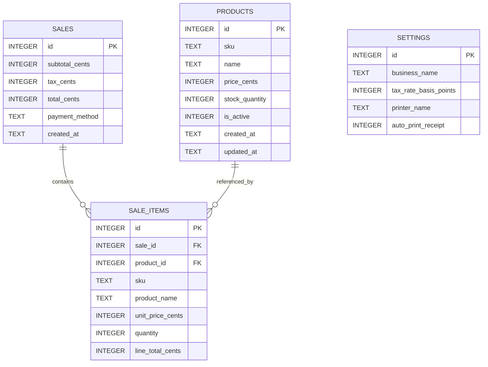

# Database Design

## 1. Overview

The MVP uses a single local SQLite database. The database stores products, completed sales, sale line items, and application settings.

The database file must be created in Electron's writable application data directory and must not be committed to Git.

## 2. Tables

### products

Stores the current product catalog.

| Column | Type | Constraints | Purpose |
|---|---|---|---|
| id | INTEGER | PRIMARY KEY | Internal product identifier |
| sku | TEXT | UNIQUE, NOT NULL | Code typed by the cashier; reserved permanently |
| name | TEXT | NOT NULL | Current product name |
| price_cents | INTEGER | NOT NULL | Current selling price in cents |
| stock_quantity | INTEGER | nullable | Current stock if inventory tracking is enabled |
| is_active | INTEGER | NOT NULL, default 1 | Soft-delete/deactivation flag |
| created_at | TEXT | NOT NULL | Creation timestamp |
| updated_at | TEXT | NOT NULL | Last update timestamp |

Money is stored as integer cents rather than floating-point values.

Example:

```text
$12.99 -> 1299
```

### sales

Stores one row per completed transaction.

| Column | Type | Constraints | Purpose |
|---|---|---|---|
| id | INTEGER | PRIMARY KEY | Sale identifier |
| subtotal_cents | INTEGER | NOT NULL | Pre-tax subtotal |
| tax_cents | INTEGER | NOT NULL | Tax charged |
| total_cents | INTEGER | NOT NULL | Final total |
| payment_method | TEXT | NOT NULL | cash or card |
| created_at | TEXT | NOT NULL | Sale timestamp |

### sale_items

Stores the line items belonging to a completed sale.

| Column | Type | Constraints | Purpose |
|---|---|---|---|
| id | INTEGER | PRIMARY KEY | Line item identifier |
| sale_id | INTEGER | NOT NULL, FK | Parent sale |
| product_id | INTEGER | nullable, FK | Original product when available |
| sku | TEXT | NOT NULL | SKU snapshot at sale time |
| product_name | TEXT | NOT NULL | Name snapshot at sale time |
| unit_price_cents | INTEGER | NOT NULL | Price snapshot at sale time |
| quantity | INTEGER | NOT NULL | Quantity sold |
| line_total_cents | INTEGER | NOT NULL | Unit price x quantity |

The SKU, name, and price are deliberately copied into `sale_items`. Historical receipts must remain correct even if a product is renamed, repriced, or removed later.

SKUs are trimmed and stored uppercase before database writes. An SKU remains reserved after its product is deactivated, and the unique constraint applies across active and inactive products. Changing an active product's SKU releases its previous value.

### settings

The MVP can use a single settings row.

| Column | Type | Constraints | Purpose |
|---|---|---|---|
| id | INTEGER | PRIMARY KEY | Settings row |
| business_name | TEXT | NOT NULL | Name printed on receipt |
| tax_rate_basis_points | INTEGER | NOT NULL | Tax rate |
| printer_name | TEXT | nullable | Selected Windows printer |
| auto_print_receipt | INTEGER | NOT NULL | Boolean flag |

A basis-point representation avoids floating-point tax configuration.

Examples:

```text
5.00%  -> 500
12.00% -> 1200
```

## 3. Relationships

```text
products
   |
   | optional historical reference
   v
sale_items >-------- sales
     many              one
```

A sale has one or more sale items.

A sale item may retain a reference to a product, but historical display must use the snapshot fields stored on the sale item.

## 4. ER Diagram



## 5. Suggested Schema

```sql
CREATE TABLE products (
    id INTEGER PRIMARY KEY AUTOINCREMENT,
    sku TEXT NOT NULL,
    name TEXT NOT NULL,
    price_cents INTEGER NOT NULL CHECK (price_cents >= 0),
    stock_quantity INTEGER CHECK (stock_quantity IS NULL OR stock_quantity >= 0),
    is_active INTEGER NOT NULL DEFAULT 1 CHECK (is_active IN (0, 1)),
    created_at TEXT NOT NULL DEFAULT CURRENT_TIMESTAMP,
    updated_at TEXT NOT NULL DEFAULT CURRENT_TIMESTAMP
);

CREATE TABLE sales (
    id INTEGER PRIMARY KEY AUTOINCREMENT,
    subtotal_cents INTEGER NOT NULL CHECK (subtotal_cents >= 0),
    tax_cents INTEGER NOT NULL CHECK (tax_cents >= 0),
    total_cents INTEGER NOT NULL CHECK (total_cents >= 0),
    payment_method TEXT NOT NULL CHECK (payment_method IN ('cash', 'card')),
    created_at TEXT NOT NULL DEFAULT CURRENT_TIMESTAMP
);

CREATE TABLE sale_items (
    id INTEGER PRIMARY KEY AUTOINCREMENT,
    sale_id INTEGER NOT NULL,
    product_id INTEGER,
    sku TEXT NOT NULL,
    product_name TEXT NOT NULL,
    unit_price_cents INTEGER NOT NULL CHECK (unit_price_cents >= 0),
    quantity INTEGER NOT NULL CHECK (quantity > 0),
    line_total_cents INTEGER NOT NULL CHECK (line_total_cents >= 0),
    FOREIGN KEY (sale_id) REFERENCES sales(id),
    FOREIGN KEY (product_id) REFERENCES products(id) ON DELETE SET NULL
);

CREATE TABLE settings (
    id INTEGER PRIMARY KEY CHECK (id = 1),
    business_name TEXT NOT NULL DEFAULT 'My Store',
    tax_rate_basis_points INTEGER NOT NULL DEFAULT 0 CHECK (tax_rate_basis_points >= 0),
    printer_name TEXT,
    auto_print_receipt INTEGER NOT NULL DEFAULT 0
        CHECK (auto_print_receipt IN (0, 1))
);
```

## 6. Indexes

The most important lookup is SKU entry during checkout.

```sql
CREATE UNIQUE INDEX idx_products_sku
ON products(sku);

CREATE INDEX idx_sales_created_at
ON sales(created_at DESC);

CREATE INDEX idx_sale_items_sale_id
ON sale_items(sale_id);
```

## 7. Sale Write Transaction

Completing a sale must be atomic.

```text
BEGIN
  insert sales row
  insert all sale_items
  update stock if enabled
COMMIT
```

If any step fails, roll back the entire transaction.

## 8. Database Migrations

Use numbered migrations from the beginning, even for a small local app.

Example:

```text
001_initial_schema.sql
002_add_inventory.sql
003_add_receipt_fields.sql
```

The app stores its schema version in SQLite's `user_version` pragma and applies pending migrations
before opening the main window. Each migration and its version update run in one transaction. The
current initial schema is `src/main/database/migrations/001_initial_schema.sql`; add a new numbered
migration for later schema changes rather than editing a migration that has shipped.

At runtime, the main process opens `pos-system.sqlite` in Electron's `userData` directory and enables
foreign key checks and write-ahead logging for that connection.
